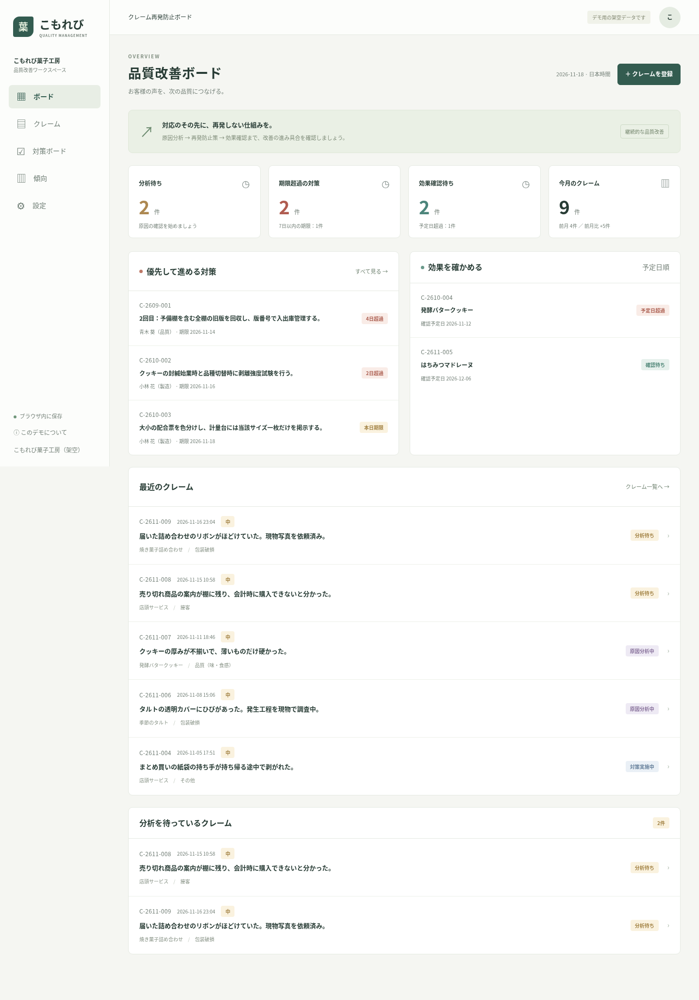

# クレーム再発防止ボード

## 概要

架空の「こもれび菓子工房」の製造・直営店・通販を想定した品質改善アプリです。
お客様から届いたクレームを、一次対応が済んだ後の原因分析から再発防止策、効果確認まで管理します。
顧客の氏名・連絡先は保持しません。認証・AI・外部API・メール通知は使用しません。

## 主な機能

### 1. クレームの登録と原因分析

受付日時・経路・商品・分類・重大度・内容・ロットまたは店舗を記録し、
`C-YYMM-連番`で自動採番します。写真は最大3枚、ブラウザ内で長辺1280px以下へ縮小します。
なぜなぜ分析を1〜5段で記入し、4Mと原因タグで整理します。
発生原因と流出原因の両方、分析者・分析日を入力すると対策実施中へ進めます。
状態変更の記録者・日時はタイムラインに残ります。

### 2. 再発防止策の担当と期限

複数の暫定対策・恒久対策を、発生対策／流出対策に分けて登録します。
担当者・期限・状態・完了日・完了メモを管理し、対策ボードで進捗を一覧できます。
期限超過は赤、7日以内は黄色と残日数で表示します。スマートフォンでは状態別タブに切り替わります。

### 3. 効果確認

恒久対策が1件以上あり、すべて完了すると最後の完了日＋分類の確認期間で予定日を算出します。
既定の確認期間は30日です。完了日を除いた前後の同じ日数で、類似クレーム件数を比較します。
予定日以降に確認者とコメントを添えて、効果あり・効果なし・30日延長を記録できます。
効果なしでは原因分析中へ戻り、理由と回数を保持します。延長時は比較の前期間も同じ日数へ拡張します。

### 4. 類似クレームの傾向

「同じ商品かつ同じ分類」または「原因タグを1つ以上共有」を類似と判定します。
登録中と詳細に直近180日の候補を表示します。
直近3・6・12か月／任意期間で、月別×分類の積み上げ棒グラフ、4M・原因タグのパレート図、
商品×分類の件数表を表示します。
効果なし率と完了後90日以内の類似クレーム再発率は、分子・分母を併記します。
90日未観察の完了は後者の分母から除外し、母数0件は0%と表示します。
一覧・対策・傾向を、期間または出力日入りのBOM付きCSVでダウンロードできます。

## 日時の扱い

- 日本時間の`YYYY-MM-DD`、`HH:MM`を使い、日時は両者を`T`でつないだ文字列として保持します。
- 現在日時・ブラウザ保存データの読み込みはクライアントのマウント後に行います。
- シードは初回に開いた日本時間を基準に、過去174日から前日までの30件を生成します。
- 店頭・電話の受付は9:00〜19:00、メール・通販レビューは7:00〜23:30に収めます。
- 受付・分析・対策完了・判定・タイムラインは過去、期限と効果確認予定日は未来を許容します。
- 月初の今月0件にも対応し、前月比は件数差で表示します。
- 確認期間の設定変更は新規登録から適用し、進行中の案件の期間は保持します。

## 既存作品との違い

| 既存作品                         | 既存作品の領域                           | 本作の領域                                                 |
| -------------------------------- | ---------------------------------------- | ---------------------------------------------------------- |
| 現場トラブル受付・修理進捗ボード | 設備故障・業者手配・修理・復旧確認       | 商品・サービスのクレームの再発防止。設備は原因の4M分類のみ |
| 問い合わせ管理システム           | 問い合わせ受付・一次対応・やり取りの管理 | 一次対応後の原因分析・改善活動                             |
| AI問い合わせ分類・回答支援アプリ | AI分類・回答作成                         | 手入力の原因分析とローカル集計。AIは不使用                 |
| 保守・点検管理システム           | 設備台帳・定期点検                       | クレーム起点の対策と効果確認                               |
| AI議事録作成アプリ               | 会議記録・AI要約                         | クレームごとの原因・対策・効果の記録                       |

謝罪文・返信文の生成、返金・交換、入荷検品、開店・閉店の定例チェックも扱いません。

## 画面一覧

| URL            | 画面                                                       |
| -------------- | ---------------------------------------------------------- |
| `/`            | 品質改善ボード                                             |
| `/claims`      | クレーム一覧・絞り込み・CSV                                |
| `/claims/new`  | クレーム登録・類似候補                                     |
| `/claims/[id]` | 詳細・原因分析・対策・効果確認・類似クレーム・タイムライン |
| `/actions`     | 対策ボード                                                 |
| `/trends`      | 傾向・グラフ・再発率                                       |
| `/settings`    | 商品・分類と確認期間・原因タグ・メンバー                   |
| `/about`       | デモ説明・既定データへの復元・写真削除                     |

## データの保存先

クレームと設定はlocalStorageの`cpb:v1`、添付写真はIndexedDBの`cpb-photos`に保存します。
保存データの形や値を検証し、破損時は既定データに戻して通知します。
ブラウザや端末間の同期はありません。一つのタブで編集してください。
ブラウザデータの削除で記録も消えます。CSVは写真を含みません。
設定は名称編集と追加に対応し、既存項目は履歴との対応を保つため削除しません。

## 技術スタック

Next.js 16 / App Router / React 19 / TypeScript / Tailwind CSS 4 / CSS / ESLint。
グラフはCSSとSVGで描画し、追加のUI・チャートパッケージは使用しません。
純粋関数を`src/lib/`へ分割し、Node.js標準のテストランナーで検証します。

## 公開URL

[クレーム再発防止ボード](https://complaint-prevention-board.vercel.app)

## スクリーンショット



02（原因分析）と04（効果確認）はスマートフォン表示（390×844）、01・03・05はPC表示（1440幅）です。

| 画面       | 画像                                                |
| ---------- | --------------------------------------------------- |
| ボード     | [01-board.png](docs/screenshots/01-board.png)       |
| 原因分析   | [02-analysis.png](docs/screenshots/02-analysis.png) |
| 対策ボード | [03-actions.png](docs/screenshots/03-actions.png)   |
| 効果確認   | [04-effect.png](docs/screenshots/04-effect.png)     |
| 傾向       | [05-trends.png](docs/screenshots/05-trends.png)     |

## ローカル起動方法

Node.js 24以上を使用します。コマンドはこのプロジェクトの直下で実行してください。

```bash
npm install
npm run dev
```

`http://localhost:3000`を開きます。本番モードは以下で起動します。

```bash
npm run build
npm start
```

検証コマンド：

```bash
npm run lint
npm run typecheck
npm test
npm run build
```

テストは採番・状態遷移・原因分析・期限・効果確認・類似判定・集計・CSV・保存データを対象とします。
0時台・4時台・朝・昼・23時台・月初・月末・年末年始のシード日時も検証します。

## デモデータについて

すべて架空のデータです。商品8件、メンバー5名、個別に記述したクレーム30件を用意しています。
日時は開いた日時からの相対で生成し、「既定データに戻す」操作時にも再生成します。
ギフト缶の配送破損が繰り返した後の緩衝材変更、表示ミスへの対策が効かず再分析した事例を含みます。
全状態、期限超過2件、7日以内の期限1件、予定日超過の効果確認1件、予定日前の確認待ち1件を含みます。
写真はアプリ内で描いた架空のイラストで、「サンプル画像（架空）」と明記しています。
実在の企業・商品・個人とは無関係です。
